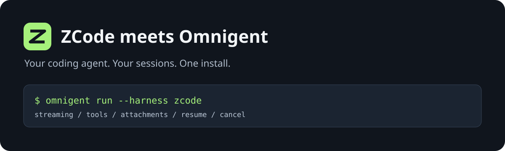
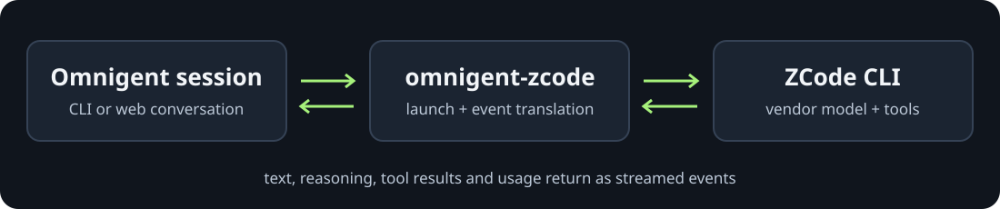

<div align="center">
  
  <br /><br />
  <a href="https://github.com/anxkhn/omnigent-zcode/actions/workflows/test.yml"></a>
  
  
  
  <a href="LICENSE"></a>
  <p><strong>Bring ZCode into your Omnigent conversations.</strong></p>
  <p><a href="#get-running">Get running</a> · <a href="#what-works">What works</a> · <a href="#configuration">Configuration</a> · <a href="#the-fine-print">The fine print</a> · <a href="#development-and-testing">Testing</a></p>
</div>

`omnigent-zcode` is a community harness for [Omnigent](https://github.com/omnigent-ai/omnigent)
that runs [Z.ai's ZCode](https://github.com/zai-org/zcode). Ask it to explore a
repository, fix a test, or explain that suspicious function. ZCode does the coding;
the plugin brings its streamed output and tool events into your Omnigent session.

## Get running

You need Python 3.12 or later, Omnigent 0.17 or later, and a working ZCode CLI.
This version has been tested with the **ZCode v3.15.1 source tag**. Its standalone
agent CLI reports `0.16.9`; that is a separate version number, not a failed build.

### 1. Install and sign in to ZCode

Follow [ZCode's installation instructions](https://github.com/zai-org/zcode).
Check that the CLI works, then complete its browser login:

```bash
zcode --help
zcode login
```

ZCode owns your credentials and model selection. Configure those in ZCode first.
The plugin does not copy or decrypt its credential store.

### 2. Install the plugin

For a uv tool installation:

```bash
uv tool install --python 3.12 \
  --with git+https://github.com/anxkhn/omnigent-zcode.git \
  "omnigent>=0.17"
```

<details>
<summary>Already using a Python virtual environment?</summary>

Install into the same environment that runs Omnigent:

```bash
uv pip install git+https://github.com/anxkhn/omnigent-zcode.git
```

The package is available from GitHub. It is not on PyPI yet.

</details>

Restart running Omnigent servers and hosts so they discover the installed plugin.
Install it on each server or host that needs to use ZCode.

### 3. Give it something to do

```bash
omnigent run --harness zcode -p "Explain this repository's entry point. Do not edit files."
```

Or start a conversation and keep going:

```bash
omnigent run --harness zcode
```

`z-code` works too. The web harness picker also gets a ZCode row from the plugin
registry. Try asking it to remember a phrase, then ask for the phrase in your next
turn. The plugin resumes the same ZCode session while its executor stays alive.

> [!IMPORTANT]
> This adapter runs ZCode in `yolo` print mode. ZCode executes its own tools
> without an Omnigent approval dialog. Use an OS sandbox when you need filesystem
> or process isolation. Omnigent tool policies do not intercept these tool calls.

## What works

| Capability | Behavior |
| --- | --- |
| Streaming | Text and reasoning arrive as ZCode emits them. |
| Tools | ZCode executes its tools; Omnigent displays their calls and results. |
| Follow-up turns | Uses ZCode's persisted session ID through `--resume`. |
| Files and images | Data URIs become local attachments passed through `--attach`. |
| Cancellation | Stops the CLI and remaining descendants, including children that ignore SIGTERM. |
| Timeouts | Bounds each turn to 10 minutes and tears down its process tree. |
| Usage | Reports token and context usage when ZCode supplies them. |
| Dynamic workflows | Opt in with `workflow_mode` on ZCode 3.15.1. Disabled by default. |
| Command overrides | Point the harness at a source build or another executable. |
| Environment filtering | Passes ZCode's environment settings without inheriting unrelated provider keys. |



Each turn starts a headless ZCode process. The plugin translates `stream-json`
events into Omnigent events. The first successful turn includes your agent's system
prompt; later turns resume the vendor session.

## Configuration

### Use an agent YAML

```yaml
name: zcode-helper
executor:
  harness: zcode
prompt: |
  Help me understand and improve this repository.
  Explain your changes and run the relevant checks.
```

Save it as `zcode-helper.yaml`, then run:

```bash
omnigent run zcode-helper.yaml -p "Find the tests for the parser"
```

The repository also includes [a small example](examples/zcode_hello.yaml).
Do not set `executor.auth` or `executor.model`. This integration uses ZCode's own
configured credentials and model, and rejects unsupported model overrides.

### Point at a source build

In your Omnigent configuration:

```yaml
harness:
  zcode:
    command: /absolute/path/to/zcode
```

`OMNIGENT_ZCODE_PATH` takes precedence. The command must be executable. For a
source build, use the built `apps/zcode-cli/packages/cli/dist/zcode.cjs` entry point
with Node on `PATH`.

Omnigent's community readiness probe checks `zcode` on `PATH`, even when the
executor uses a command override. Keep a `zcode` command available to the host.

<details>
<summary>Build the tested ZCode source tag</summary>

ZCode pins Node 24.14.0 and pnpm 10.33.2 for this tag. Using nvm and Corepack:

```bash
git clone --branch v3.15.1 --depth 1 https://github.com/zai-org/zcode.git
cd zcode
nvm install 24.14.0
nvm use 24.14.0
corepack pnpm install --filter @zcode/cli... --frozen-lockfile
corepack pnpm --filter @zcode/cli... build
node apps/zcode-cli/packages/cli/dist/zcode.cjs --help
```

The source tag is 3.15.1, but the standalone CLI's own `--version` is 0.16.9.

</details>

### Enable dynamic workflows

ZCode 3.15.1 supports headless workflows. Add the mode to your agent configuration:

```yaml
executor:
  harness: zcode
  config:
    workflow_mode: onDemand
```

Accepted values are `disabled`, `onDemand`, and `alwaysOn`. `onDemand` makes
workflows available when requested; `alwaysOn` exposes the workflow tools up front.
The plugin passes ZCode's `--workflow-mode` option and leaves workflow execution
to ZCode. Workflow progress is not mapped to dedicated Omnigent progress cards.
Older ZCode versions may not recognize this option, so leave it unset on those.

### Limit tool selection

```yaml
executor:
  harness: zcode
  config:
    disallowed_tools:
      - Bash
      - Write
      - Edit
```

This changes ZCode's tool selection. It is not an OS access boundary.

### Attachments and sandboxing

The plugin stores uploaded data-URI attachments in a session cache outside your
workspace. It removes the cache when the session closes. Local attachment paths
must resolve inside the workspace or that session's cache. Remote HTTP URLs are
rejected rather than downloaded.

Sandboxed follow-up turns keep read access to earlier cached attachments. An
active sandbox also needs explicit grants for ZCode's own credential, provider
configuration, and session-storage files. ZCode's tools share those grants.

## The fine print

These are **integration limits**, not a claim that ZCode lacks the feature:

| Area | Current status |
| --- | --- |
| Model override | ZCode 3.15.1 has no `--model` flag. Choose the model in ZCode; Omnigent model overrides are rejected. |
| Approvals | Print mode has no interactive response channel. The plugin supports `yolo`; other permission modes are rejected. |
| Omnigent policies | Tool events are observations. The plugin cannot approve or deny ZCode's internally executed tools. |
| MCP | ZCode supports its own configured MCP servers. This plugin does not bridge Omnigent's MCP tools into them. |
| Restart and fork | ZCode can resume persisted sessions, but the plugin's Omnigent-to-ZCode ID mapping is process-local. No automatic recovery or history replay after an executor restart or fork. |
| Compaction | ZCode has compaction; the plugin does not emit dedicated Omnigent compaction events. |
| Cost | Token counts are forwarded. No dollar-cost calculation or reporting. |
| Native terminal | No `omnigent zcode` TUI wrapper. Use `omnigent run --harness zcode`. |
| Login status | Core checks CLI availability. Vendor login errors appear at runtime; no custom setup-menu row or credential probe. |

<details>
<summary>Why can the startup header show a different provider?</summary>

Omnigent 0.17's startup header and `/model` readout can display an unrelated global
provider default for an own-auth community harness. ZCode still uses its own
credentials and model. Those displays do not change the subprocess configuration.

</details>

<details>
<summary>Which environment variables reach ZCode?</summary>

Omnigent's safe base environment, `ZCODE_*`, `ZAI_OAUTH_ORIGIN`,
`ZAI_BUSINESS_BASE_URL`, `ZAI_OAUTH_CLIENT_ID`, and `BIGMODEL_API_BASE_URL`.
Use `os_env.sandbox.env_passthrough` to explicitly permit additional names.

ZCode normally keeps credentials in `~/.zcode/v2/credentials.json` and provider
selection in `~/.zcode/v2/provider_config.json`. `ZCODE_DATA_BASE_DIR` changes
the base directory.

</details>

## Development and testing

```bash
git clone https://github.com/anxkhn/omnigent-zcode.git
cd omnigent-zcode
uv sync --group dev
uv run ruff check .
uv run ruff format --check .
uv run pytest
uv build
```

The default suite uses a fake ZCode executable and requires no vendor account.
The opt-in suite runs the **real built ZCode CLI** against a local streaming model
provider, including its real file tools. It covers text, reasoning, usage, resume,
file reads and writes, tool errors, file and image attachments, cancellation,
timeouts, workflow mode selection, and the plugin's HTTP app.

```bash
ZCODE_TEST_CLI=/absolute/path/to/zcode/apps/zcode-cli/packages/cli/dist/zcode.cjs \
ZCODE_TEST_SOURCE=/absolute/path/to/zcode \
uv run pytest tests/test_real_zcode.py
```

Tests isolate vendor state and model configuration. No Z.ai credentials are
needed. These deterministic tests verify integration behavior, not GLM response
quality or Coding Plan quota and billing. See [the verification report](docs/verification.md)
for the exact versions and results.

### Omnigent compatibility

The dependency is `omnigent>=0.17`, with no arbitrary upper cap. Tested against
the published 0.17.0 package and the 0.18.0.dev0 source checkout. The plugin uses
some executor and sandbox helpers that are internal to Omnigent, so future API
changes can still require a plugin update. A successful install is not a promise
that every future version has already been tested.

## Found a rough edge?

Open [an issue](https://github.com/anxkhn/omnigent-zcode/issues) with your OS,
Python version, Omnigent version, ZCode source or CLI version, and a small
reproduction. Remove tokens and private repository content from logs.

Small fixes and focused tests are welcome. Keep the adapter boring so the coding
agent gets to do the interesting part.

## License

[Apache-2.0](LICENSE).
